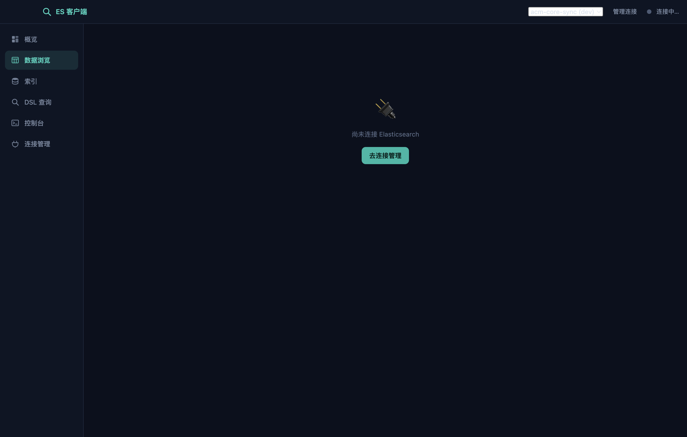
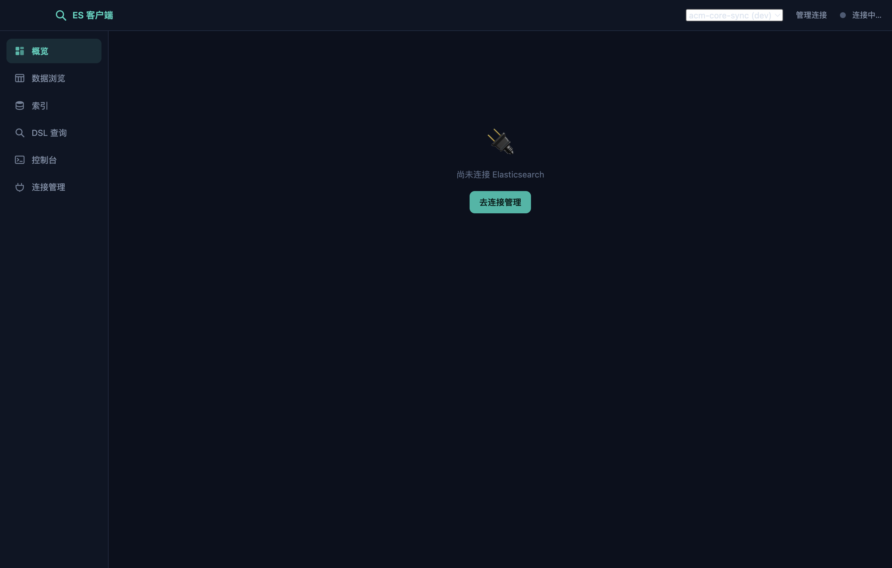
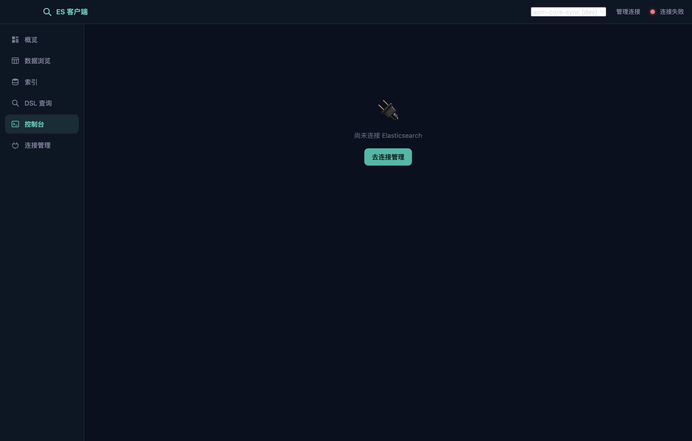

<div align="center">


# ES客户端 · ESClient

**跨平台 Elasticsearch 桌面客户端 · Cross-platform Elasticsearch Desktop Client**

像数据库工具一样按字段查数据,**不写 DSL 也能精准查询**

Browse and edit Elasticsearch like a database tool — **zero DSL required**

[](../../releases)
[](../../releases)
[](./LICENSE)
[](../../stargazers)

**[⬇️ 下载安装](#-下载安装)** · **[✨ 功能特性](#-功能特性)** · **[🆚 对比](#-为什么选-es客户端)** · **[🚀 快速上手](#-快速上手)**

**如果这个工具帮到了你,欢迎点一个 ⭐ Star 让更多需要的人看到它!**

</div>

---



## ✨ 功能特性

### 🗄 数据浏览 —— 像数据库客户端一样用 ES

| 数据库工具里你习惯的 | ES客户端里对应的 |
|---|---|
| 选表 | 下拉选索引 |
| `WHERE` 字段条件 | 字段下拉 + 操作符下拉(**等于 / 包含 / 短语 / 前缀 / 通配符 / 大于 / 区间 / 为空 / 为 true**),操作符按字段类型自动适配 |
| `ORDER BY` / 分页 | 点列排序、翻页、跳页 |
| 列配置 | 表头 ✕ 快速隐藏列、「列显示」搜索/全选/记忆 |
| 双击行编辑 | 点行即看完整 JSON,在线**编辑/删除/新增文档** |
| 全表搜 | 顶部「全字段快速搜索」,输入关键词回车即查 |

字段列表 = **完整 mapping(自动解析全部层级与多字段)+ 文档采样兜底**,条件翻译出的 DSL 可随时展开查看。

### 🖥 控制台 —— Kibana Dev Tools 风格的原生 DSL 入口

一个编辑器写多个请求(`GET /索引/_search` + JSON 体),**光标放在哪个请求上,⌘/Ctrl+回车就执行哪个**;支持 `#` 注释、JSON 格式化、历史记录、任意 REST API(bulk / reindex / _sql…)。



### 其他

- **DSL 查询**:常用模板(match / term / range / bool / 聚合)、格式化、表格⇄JSON 双视图
- **索引管理**:健康度 / 文档数 / 大小一览,查看 mapping & settings,新建 / 打开 / 关闭 / 删除(删除需输入索引名二次确认)
- **集群概览**:健康状态、版本、节点、分片、文档总数、存储大小
- **多连接管理**:Basic / ApiKey / 无认证,自签名证书可忽略校验
- 适配 **ES 6.x / 7.x / 8.x**

### 🛡 安全设计(共用集群友好)

- **索引白名单**:开启后仅白名单内索引**可见、可读、可写**——界面不显示其他索引,`_all` 查询、`_cat` 列表、bulk 全部在主进程拦截或改写,控制台也绕不过
- **危险操作屏蔽**:删除索引 / 关闭索引 / `_delete_by_query` 一律拦截(即使白名单内)



## 🆚 为什么选 ES客户端

| | ES客户端 | Kibana Dev Tools | elasticvue | Cerebro |
|---|---|---|---|---|
| 免 DSL 按字段查数据 | ✅ 操作符按字段类型自适应 | ❌ | 部分 | ❌ |
| 文档在线编辑 / 新增 | ✅ | ✅ | ✅ | ❌ |
| 多请求 DSL 控制台 | ✅ 同 Kibana 用法 | ✅ | ❌ | ❌ |
| 索引白名单(不可见/不可读/不可写) | ✅ 连接级防护 | ❌ | ❌ | ❌ |
| 删索引强制二次确认 / 危险操作屏蔽 | ✅ | ❌ | 部分 | ❌ |
| 桌面单文件,零部署 | ✅ 开箱即用 | ❌ 需部署服务 | 浏览器 | 需部署 |

> Kibana 依然是运维标配;ES客户端 定位是**个人开发者的日常查询/排查工具**——30 秒下载,填个地址就能查数据。

## 📦 下载安装

到 [**Releases**](../../releases) 下载最新版:

| 系统 | 文件 | 说明 |
|---|---|---|
| macOS (Apple Silicon) | `ESClient-v*-macos-arm64.dmg` | 打开拖入 Applications;首次打开右键→打开 |
| macOS (Intel) | 下载 universal 版或从源码构建 | |
| Windows x64 | `ESClient-v*-win-x64-portable.zip` | 解压直接运行 `ESClient.exe`,免安装 |

<details>
<summary>🧰 从源码运行 / 构建</summary>

```bash
npm install
npm start          # 开发运行
npm run dmg        # 打 macOS DMG
npm run win        # 交叉打包 Windows 便携版
```

推 tag(`git tag v1.0.2 && git push origin v1.0.2`)即由 GitHub Actions 自动构建并发布双平台安装包。
</details>

## 🚀 快速上手

1. 打开应用 → 「连接管理 → + 新增连接」→ 填 ES 地址和账号;
2. 「数据浏览」选索引、按字段筛数据;复杂查询去「DSL 查询」或「控制台」;
3. 共用集群?编辑连接 → 开启「安全防护」(白名单 + 危险操作屏蔽)。

连接配置保存在本机(`~/Library/Application Support/ES客户端/` 或 `%APPDATA%\ES客户端\`),密码明文存储,请勿在公共电脑保存敏感密码。

<details>
<summary>English</summary>

**ESClient** is a lightweight cross-platform (macOS/Windows) desktop client for Elasticsearch:

- Browse & edit documents like a database tool — pick a field, pick an operator, zero DSL
- Kibana-Dev-Tools-style console for raw REST/DSL (multi-request editor, run at cursor)
- Index management, cluster overview, multi-connection (Basic auth / API key)
- Connection-level safety: index whitelist (invisible / unreadable / unwritable outside the list) and dangerous-operation blocking (delete index, close index, delete-by-query)
- Works with ES 6.x / 7.x / 8.x · Electron · MIT License

Download from [Releases](../../releases). If you like it, please ⭐ Star the repo!
</details>

## 🗺 Roadmap

- [ ] Windows NSIS 安装器
- [ ] 在线演示(GitHub Pages,内置演示模式)
- [ ] 聚合结果可视化图表
- [ ] 索引别名管理
- [ ] SQL 查询标签页

## 🤝 贡献

Issue / PR 欢迎!功能建议、界面翻译、安装包签名经验都算贡献。

## License

[MIT](./LICENSE)

---

<div align="center">

**觉得好用就点个 ⭐ 吧,这是持续维护的最大动力!**

</div>
